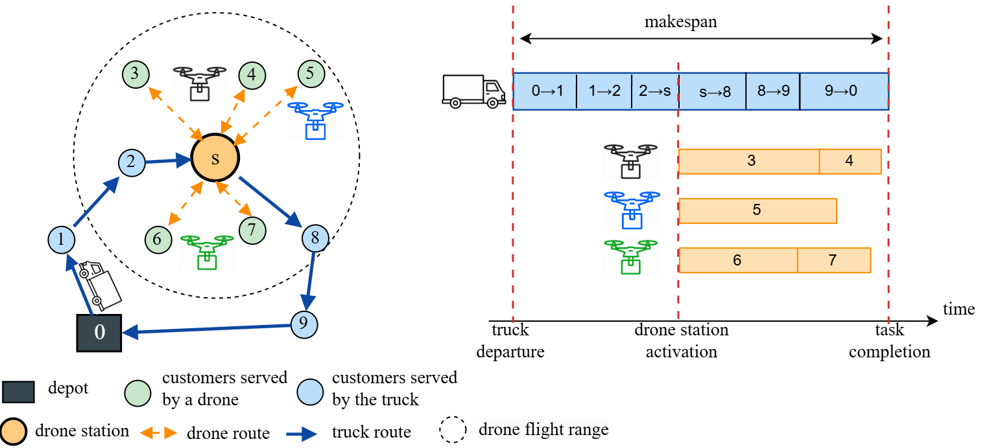

# Large-Scale Travelling Salesman Problem with Drone Station: Heuristic and Approximation Algorithms
The software and data in this repository are a snapshot of the software and data that were used in the research reported on in the paper.

# Description
Truck-drone coordination has emerged as a promising solution to meet the increasing demand for last-mile delivery.
A representative problem is called the travelling salesman problem with a drone station (TSP-DS), which asks to plan the route of a truck and the scheduling of $m$ drones so that the truck and drones can transport goods cooperatively to all customers, and the objective is to minimize the delivery makespan. 

However, the problem is computationally challenging in large-scale and real-world instances.
In this paper, we explore both a practical memetic algorithm, TD-Memetic, and a theoretical approximation algorithm, TD-Appro, for this problem. 
One key component of TD-Memetic is a new crossover which decomposes and recombines three fragments of the parent solutions.
Another important component is a multi-neighbourhood local search which incorporates six different neighbourhoods to improve the offspring solution. 
On the other hand, TD-Appro is a polynomial-time heuristic with $5$-approximation guarantee.

Both algorithms are evaluated on 216 instances of different structures in the experiments. 
Notably, TD-Memetic achieves the best known value on 164 instances and improves it on 50 large and real-world instances, demonstrating state-of-the-art empirical performance.
Meanwhile, TD-Appro is better than its theoretical bounds -- the objective of the solutions found by this algorithm is much better than its theoretical guarantee.

<p align="center">
  
</p>

This project contains three folders which contain three algorithms: TD-Memetic (TSPDS folder), TD-Appro (APPROXIMATE folder) and TPLS (TPLS folder).

# Prerequisites
The codes are implemented under Ubuntu 22.04. Boost C++ 17 is also required for running the codes.

# Build and Run TD-Memetic
In Linux operating system, enter the project directory, put the dataset into TSP-DS/TSPDS/data/tsp_origan, and run the program as follows:
```
cd TSP-DS/TSPDS

rm -rf build

cmake -S . -B build \
  -DCMAKE_BUILD_TYPE=Release

cmake --build build -j$(nproc)

./build/bin/TSPDS.out
```

# Build and Run TD-Appro
Compile:
```
cd TSP-DS/APPROXIMATE

g++ -std=c++17 -O2 appro.cpp -o appro

./appro ./data/[dataset name].csv [#drones] [truck travel time/per mile, 1 by default] [drone travel time/per mile, 0.5 by default] [result file name].csv
```

# Build and Run TPLS
In Linux operating system, enter the project directory, put the dataset into TSP-DS/MTSPDS/data/tsp_origan, and run the program as follows:
```
cd TSP-DS/TPLS

rm -rf build

cmake -S . -B build \
  -DCMAKE_BUILD_TYPE=Release

cmake --build build -j$(nproc)

./build/bin/MTSPDS.out
```
